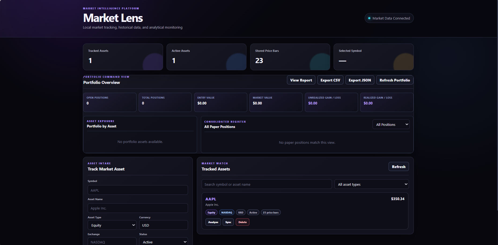
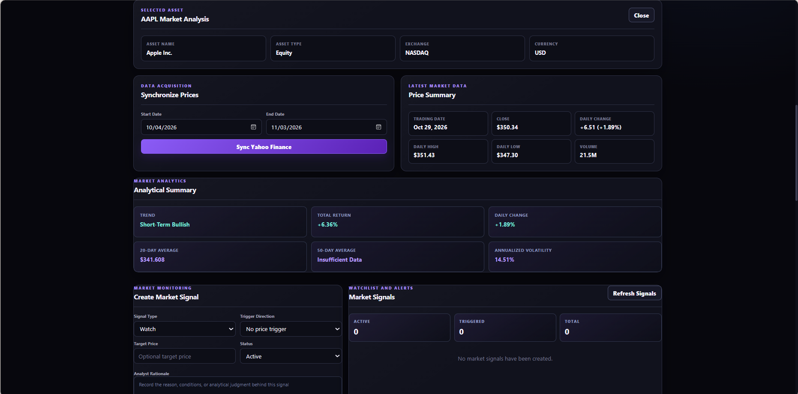
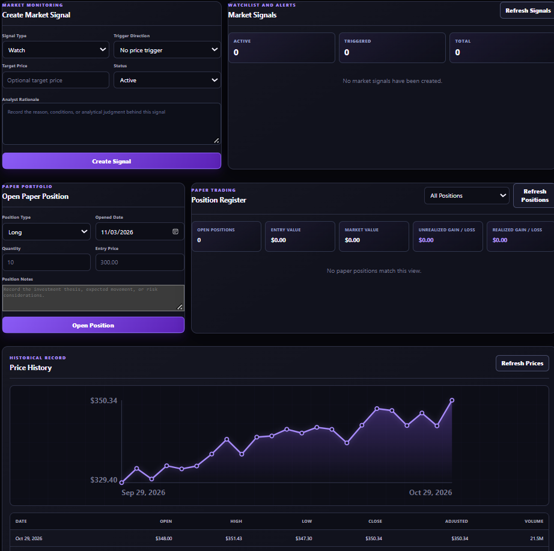
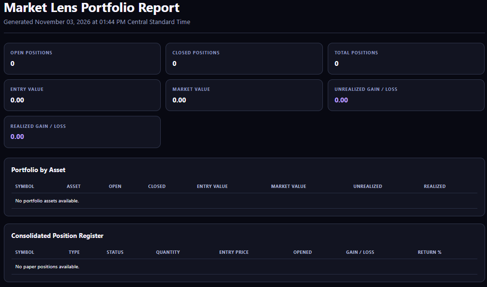

# Market Lens

Market Lens is a local market-intelligence, analytical monitoring, and paper-portfolio application built with FastAPI, SQLAlchemy, SQLite, and vanilla JavaScript.

The application allows users to track market assets, synchronize historical pricing from Yahoo Finance, calculate technical analytics, create price-monitoring signals, record simulated long and short positions, and evaluate performance across an entire paper portfolio.

Market Lens is designed as a standalone service and as a future market-analysis component for the Artemis local AI ecosystem.

## Version

**Market Lens v1.0.0**

Developed by CIN Entertainment.

## Features

### Market Asset Management

- Add equities, ETFs, indices, cryptocurrencies, mutual funds, and other assets
- Store symbols, names, exchanges, currencies, asset types, and activity status
- Search and filter the tracked-asset register
- Update and delete tracked assets
- Prevent duplicate symbols

### Yahoo Finance Synchronization

- Retrieve historical market data through Yahoo Finance
- Select custom synchronization date ranges
- Store open, high, low, close, adjusted-close, and volume data
- Create new price records and update existing records
- Prevent duplicate asset/date price bars
- Handle invalid symbols and provider failures

### Market Analytics

Market Lens calculates:

- Latest closing price
- Daily percentage change
- Total return
- 20-day moving average
- 50-day moving average
- Annualized volatility
- Short-term bullish or bearish trend classification

Analytics are generated from locally stored price history.

### Price History

- Interactive closing-price chart
- Chronological historical records
- Daily OHLC price information
- Adjusted-close values
- Trading volume
- Custom synchronization periods

### Market Signals

Users can create market-monitoring signals with:

- Watch, Buy, Sell, Review, and Risk classifications
- Target prices
- Above-target or below-target trigger directions
- Analytical rationale
- Active or inactive status
- Automatic trigger evaluation against the latest stored price

Signals are reevaluated when current market data is synchronized or refreshed.

### Paper Portfolio

Market Lens supports simulated positions without connecting to a brokerage or using real funds.

Capabilities include:

- Long and short paper positions
- Fractional or whole-unit quantities
- Entry prices and opening dates
- Position notes and analytical rationale
- Current market valuation
- Unrealized gain or loss
- Realized gain or loss
- Percentage return
- Position closing with exit price and closing date
- Open and closed position filtering
- Position deletion

### Portfolio Command View

The portfolio-wide dashboard combines positions across all tracked assets and displays:

- Open position count
- Closed position count
- Total position count
- Total entry value
- Current market value
- Unrealized gain or loss
- Realized gain or loss
- Per-asset exposure
- Consolidated paper-position register
- Direct navigation to individual asset analysis

### Export and Reporting

Market Lens provides:

- JSON portfolio backup
- CSV consolidated position export
- Printable HTML portfolio report
- Per-asset valuation summaries
- Realized and unrealized performance reporting


with:

```markdown
## Screenshots

### Dashboard and Portfolio Command View



### Asset Analysis



### Market Monitoring and Paper Portfolio



### Portfolio Report



## Technology Stack

### Backend

- Python 3.11
- FastAPI
- SQLAlchemy
- Pydantic
- SQLite
- Uvicorn

### Market Data

- yfinance
- pandas
- NumPy

### Frontend

- HTML5
- CSS3
- Vanilla JavaScript
- SVG price charts

### Testing

- pytest
- FastAPI TestClient
- In-memory SQLite test database

## Project Structure

```text
market-lens/
├── app/
│   ├── providers/
│   │   ├── __init__.py
│   │   └── yahoo_finance.py
│   ├── static/
│   │   ├── app.js
│   │   ├── index.html
│   │   ├── portfolio.js
│   │   └── styles.css
│   ├── __init__.py
│   ├── analytics.py
│   ├── database.py
│   ├── main.py
│   ├── models.py
│   ├── reporting.py
│   └── schemas.py
├── tests/
│   ├── test_analytics.py
│   ├── test_main.py
│   └── test_reporting.py
├── .gitignore
├── requirements.txt
└── README.md
```

## Installation

### 1. Clone the Repository

```powershell
git clone https://github.com/CINentertainment/market-lens.git
cd market-lens
```

### 2. Create a Virtual Environment

```powershell
py -m venv .venv
```

### 3. Activate the Virtual Environment

```powershell
.\.venv\Scripts\Activate.ps1
```

If PowerShell blocks script execution, temporarily allow activation for the current terminal:

```powershell
Set-ExecutionPolicy `
    -Scope Process `
    -ExecutionPolicy Bypass
```

Then activate the environment again:

```powershell
.\.venv\Scripts\Activate.ps1
```

### 4. Install Dependencies

```powershell
python -m pip install --upgrade pip
python -m pip install -r requirements.txt
```

## Running Market Lens

Start the application:

```powershell
python -m uvicorn app.main:app --reload
```

Open the dashboard:

[http://127.0.0.1:8000/dashboard](http://127.0.0.1:8000/dashboard)

Interactive API documentation is available at:

[http://127.0.0.1:8000/docs](http://127.0.0.1:8000/docs)

Alternative API documentation is available at:

[http://127.0.0.1:8000/redoc](http://127.0.0.1:8000/redoc)

Keep the PowerShell window running while using the application.

Press `Ctrl + C` to stop the server.

## Basic Workflow

### Add an Asset

1. Open the Market Lens dashboard.
2. Enter the market symbol.
3. Provide the asset name, type, exchange, and currency.
4. Select whether the asset is active.
5. Click **Add Asset**.

Example symbols:

```text
AAPL
MSFT
NVDA
SPY
QQQ
BTC-USD
^GSPC
```

### Synchronize Market Data

1. Select **Analyze** for a tracked asset.
2. Choose a start and end date.
3. Click **Sync Yahoo Finance**.
4. Review the stored price history and analytics.

### Create a Market Signal

1. Select an asset.
2. Open the Market Signals section.
3. Choose a signal type and trigger direction.
4. Enter the target price.
5. Record the analytical rationale.
6. Click **Create Signal**.

### Open a Paper Position

1. Select an asset.
2. Choose Long or Short.
3. Enter the quantity and entry price.
4. Select the opening date.
5. Record optional notes.
6. Click **Open Position**.

### Close a Paper Position

1. Locate the open position.
2. Click **Close Position**.
3. Enter the exit price.
4. Enter the closing date.
5. Review the realized gain or loss.

### Export Portfolio Information

From the Portfolio Overview panel:

- Click **View Report** for the printable HTML report.
- Click **Export CSV** for the consolidated position register.
- Click **Export JSON** for the complete portfolio backup.

## API Overview

### Application

| Method | Endpoint | Purpose |
|---|---|---|
| GET | `/` | Application information |
| GET | `/health` | Health check |
| GET | `/dashboard` | Web dashboard |

### Assets

| Method | Endpoint | Purpose |
|---|---|---|
| POST | `/assets` | Create an asset |
| GET | `/assets` | List assets |
| GET | `/assets/{asset_id}` | Retrieve an asset |
| PATCH | `/assets/{asset_id}` | Update an asset |
| DELETE | `/assets/{asset_id}` | Delete an asset |

### Market Data

| Method | Endpoint | Purpose |
|---|---|---|
| POST | `/assets/{asset_id}/sync` | Synchronize Yahoo Finance data |
| POST | `/assets/{asset_id}/prices` | Create a price bar |
| GET | `/assets/{asset_id}/prices` | List price bars |
| DELETE | `/assets/{asset_id}/prices/{price_id}` | Delete a price bar |

### Analytics

| Method | Endpoint | Purpose |
|---|---|---|
| GET | `/assets/{asset_id}/analytics` | Generate asset analytics |

### Market Signals

| Method | Endpoint | Purpose |
|---|---|---|
| POST | `/assets/{asset_id}/signals` | Create a signal |
| GET | `/assets/{asset_id}/signals` | List signals |
| GET | `/assets/{asset_id}/signals/{signal_id}` | Retrieve a signal |
| PATCH | `/assets/{asset_id}/signals/{signal_id}` | Update a signal |
| DELETE | `/assets/{asset_id}/signals/{signal_id}` | Delete a signal |

### Paper Positions

| Method | Endpoint | Purpose |
|---|---|---|
| POST | `/assets/{asset_id}/positions` | Open a paper position |
| GET | `/assets/{asset_id}/positions` | List paper positions |
| GET | `/assets/{asset_id}/positions/{position_id}` | Retrieve a position |
| PATCH | `/assets/{asset_id}/positions/{position_id}` | Update an open position |
| POST | `/assets/{asset_id}/positions/{position_id}/close` | Close a position |
| DELETE | `/assets/{asset_id}/positions/{position_id}` | Delete a position |

### Portfolio

| Method | Endpoint | Purpose |
|---|---|---|
| GET | `/portfolio/summary` | Portfolio-wide summary |
| GET | `/portfolio/export.json` | Download portfolio JSON |
| GET | `/portfolio/export.csv` | Download portfolio CSV |
| GET | `/portfolio/report` | View printable HTML report |

## Testing

Run the complete automated test suite:

```powershell
python -m pytest -v
```

The v1.0 release includes **76 automated tests** covering:

- Asset CRUD operations
- Input validation
- Price-history storage
- Market-data synchronization
- Provider failures
- Analytics calculations
- Signal creation and triggering
- Long and short position valuation
- Position closing
- Portfolio aggregation
- CSV export
- JSON export
- HTML reporting
- Dashboard delivery
- Missing-resource handling

Run a specific test file:

```powershell
python -m pytest tests\test_main.py -v
```

Check Python syntax:

```powershell
python -m py_compile app\main.py
python -m py_compile app\schemas.py
python -m py_compile app\reporting.py
```

## Database

Market Lens uses a local SQLite database.

The database is created automatically when the application starts. Local database files should remain excluded from Git version control.

Deleting the local database removes locally stored:

- Assets
- Price history
- Signals
- Paper positions

Export important portfolio information before intentionally removing the database.

## Artemis Integration

Market Lens is structured to support future integration with Artemis.

A future Artemis workflow could:

1. Research potential symbols using approved sources.
2. Analyze price history, trends, volatility, volume, and market context.
3. Score candidate assets against defined analytical rules.
4. Propose assets for human approval.
5. Add approved symbols through the Market Lens API.
6. Synchronize price history.
7. Create documented market signals.
8. Monitor stored assets and report triggered conditions.

Recommended Artemis operating modes:

- **Research mode:** Identify and analyze candidates only.
- **Proposal mode:** Prepare assets and signals for human approval.
- **Autonomous monitoring mode:** Add and monitor assets within defined limits.

Artemis should not place real-money trades or access brokerage accounts without a separately designed and explicitly authorized control architecture.

## Current Limitations

- Market Lens is a local single-user application.
- No user authentication or role-based access control is included.
- Market synchronization is initiated manually.
- Monitoring does not continue while the application is closed.
- Signals use the latest locally stored price.
- Market data depends on Yahoo Finance availability.
- Portfolio totals assume values are meaningfully comparable; no foreign-exchange conversion is currently performed.
- Paper positions do not execute real trades.
- The application does not connect to brokerage accounts.
- No tax, fee, commission, dividend, or slippage calculations are included.

## Security and Privacy

Market Lens runs locally and stores its operational data in a local SQLite database.

Recommended practices:

- Do not commit local database files.
- Do not store brokerage credentials in the project.
- Do not expose the development server directly to the public internet.
- Review API security before deploying outside a trusted local environment.
- Back up important portfolio information through JSON or CSV export.

## Disclaimer

Market Lens is an educational, analytical, and paper-trading application.

It does not provide financial, investment, tax, or legal advice. Market information may be delayed, incomplete, or inaccurate. Users are responsible for independently verifying market data and making their own financial decisions.

No feature in Market Lens executes real trades or guarantees investment performance.

## Release Status

Market Lens v1.0.0 is feature-complete as a local market-intelligence and paper-portfolio application.

Release validation includes:

- Clean Git working tree
- Successful dependency installation
- Successful application startup
- Dashboard verification
- Export and report verification
- 76 passing automated tests
- Version consistency review

## License

Copyright © 2026 CIN Entertainment.

Add the appropriate project license before permitting redistribution, modification, or commercial reuse.